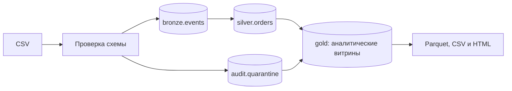

# Конспект: от CSV с заказами до проверенных витрин продаж

Версия 0.1.0. Конспект дополнен 15 октября 2026 года.
Стек: Python, DuckDB, SQL, CSV и Parquet.
[Запуск](README.md) · [Контракт данных](docs/DATA-CONTRACT.md) ·
[Фактические проверки](VALIDATION.md).

## 1. Какую задачу решаем

Представим магазин, который присылает файлы заказов. Сегодня файл содержит оплаченный
заказ, а через два дня приходит его новая версия со статусом возврата. Иногда поставщик
повторяет строку или присылает неправильное количество. Простая сумма всех CSV даст
ошибочный результат: один заказ можно посчитать несколько раз, а возврат не учесть.

Нужен конвейер, который принимает поставки, отличает новые сведения от повторов,
сохраняет историю событий и строит понятную картину текущих продаж. Результат проекта —
локальная база DuckDB, три аналитические витрины, их выгрузки и русский HTML-отчёт.
Все примеры синтетические. Это учебная модель с одной товарной позицией в заказе.

## 2. Какие навыки здесь изучаются

**Контракт данных** описывает допустимую форму входа: какие поля обязательны, какие
значения разрешены и что считать ошибкой. Без контракта одна и та же строка может
трактоваться разными частями программы по-разному.

**Идемпотентность** означает, что повторная обработка тех же сведений не добавляет
заказы и не увеличивает выручку. При этом запись в журнале запуска может появиться:
технический факт попытки отличается от изменения бизнес-данных.

**Детализация таблицы** — ответ на вопрос «что означает одна строка». В событиях это
версия заказа, в актуальных заказах — один заказ, в дневной витрине — дата и страна.
Смешение детализаций часто приводит к двойному счёту после объединения таблиц.

**Транзакция** объединяет запись событий и отметок о загруженных файлах.
Если одна часть не удалась, нельзя сохранить другую как успешную.

DuckDB выбран как небольшой локальный SQL-движок с поддержкой аналитических выгрузок.
Серверная база была бы полезна для нескольких клиентов и постоянного сервиса,
но для этого примера увеличила бы объём настройки.

## 3. Контракт и синтетические поставки

Поля CSV закреплены в `retail_pipeline/contracts.py`. `event_id` обозначает событие,
`order_id` — заказ, `version` — номер его версии. `ordered_at` хранит исходное время
заказа, `updated_at` — время обновления. Оба времени задаются в UTC с окончанием Z.
Остальные поля описывают статус, товар, количество, цену и код страны.

Цена хранится целым числом центов USD. Две позиции по 450 центов дают 900 центов.
Такой расчёт не использует двоичное число с плавающей точкой для денег.
Коды статусов технические: `paid`, `cancelled`, `refunded`.

`synthetic.py` создаёт данные из констант и фиксируемого начального значения генератора.
Стандартный набор содержит 10 000 заказов, 1 000 обновлений, 100 повторов
и 6 ошибочных строк. Профиль, личные документы и настоящие продажи не читаются.
Одинаковые параметры генератора дают одинаковое содержимое файлов в этой реализации.

При изменении заказа его дата, товар и страна остаются постоянными. Новая версия
может менять статус, количество или цену. Для реального магазина эти допущения
потребовалось бы согласовать с источником, а не переносить автоматически.

## 4. Как устроен проект

`__main__.py` разбирает команды и показывает русские сообщения. `synthetic.py`
отвечает за демо. `pipeline.py` управляет чтением, транзакцией и выгрузками.
SQL вынесен в `sql/schema.sql`, `sql/validate.sql` и `sql/marts.sql`.
`report.py` оформляет готовые результаты и не рассчитывает отдельную бизнес-логику.



Названия bronze, silver и gold обозначают последовательные уровни подготовки.
Здесь bronze уже содержит проверенные нормализованные события. Нельзя называть его
полным архивом сырого источника: ошибочные исходные значения туда не попадают.
Первоначальные CSV остаются во входной папке пользователя.

## 5. Чтение и проверка значений

Python сначала читает файл с ограничением размера и вычисляет SHA-256 его байтов.
Далее проверяет заголовок и разбирает CSV. Локальные пути не сохраняются в журнале
источников: для определения уже загруженного содержимого нужен хэш.

Поля временной таблицы первоначально имеют тип VARCHAR. Проверка в SQL явно отделяет
некорректное значение от допустимого. Например, для количества нужны и допустимая
запись целого числа, и диапазон:

```sql
WHEN NOT regexp_full_match(quantity, '[0-9]+')
     OR try_cast(quantity AS INTEGER) NOT BETWEEN 1 AND 1000
     OR try_cast(quantity AS INTEGER) IS NULL THEN 'quantity'
```

Один `try_cast` не выражает весь контракт. Здесь строка `1.5` должна отклоняться,
даже если механизм преобразования мог бы привести её к целому. `try_cast` помогает
проверить ошибку без аварии всей проверки, регулярное выражение ограничивает запись.

Неверное число полей отправляет отдельную строку в карантин. Другой заголовок или
сломанная структура CSV отменяет пакет: программа не должна угадывать смысл столбцов.
Карантин хранит хэш источника, позицию строки и первую причину отказа, без копии
всех исходных значений. Причин для одной строки может быть несколько, но эта версия
показывает только первую по порядку проверки.

## 6. Два уровня защиты от дублей

Первый уровень — содержимое файла. Хэш уже загруженного CSV есть в `audit.sources`:
повторный файл пропускается, даже если его переименовали.
Изменение пробелов или порядка строк меняет байты и хэш. Поэтому одного уровня мало.

Второй уровень — события. У `event_id` есть нормализованное содержимое и его хэш.
Полностью одинаковые события не добавляются повторно. Но одинаковый код с другим
содержимым — конфликт, а не обычный дубль. Нельзя молча принять последнюю встретившуюся
строку: результат стал бы зависеть от порядка файлов.

Дополнительно пара `(order_id, version)` должна соответствовать одному событию.
Конфликт любой из этих идентичностей отменяет весь новый пакет.
Это строгая учебная политика. В другой системе можно было бы изолировать конфликт,
но тогда нужно отдельно определить последствия для полноты отчёта.

## 7. Как выбирается актуальный заказ

История остаётся в `bronze.events`. Для `silver.orders` SQL нумерует версии внутри
заказа и выбирает первую:

```sql
QUALIFY row_number() OVER (
    PARTITION BY order_id ORDER BY version DESC
) = 1
```

`PARTITION BY` разделяет события на группы заказов. `ORDER BY version DESC` ставит
наибольшую версию первой. Благодаря этому поздно пришедшая старая версия пополнит
историю, но не откатит текущее состояние.

Версия определяется договорённостью источника. Время обновления проверяется
на неубывание между версиями; оно не заменяет номер версии в выборе последнего состояния.

## 8. Небольшой пример от входа до результата

Возьмём пять строк с одинаковой датой заказа и страной GB:

| Строка | Заказ и версия | Статус | Товар, количество и цена | Результат |
| --- | --- | --- | --- | --- |
| 1 | ORD-00000001, версия 1 | paid | SKU-01, 2 × 450 центов | Новое событие |
| 2 | Точная копия строки 1 | paid | Те же значения | Дубль |
| 3 | ORD-00000001, версия 2 | refunded | Те же товар, количество и цена | Обновление |
| 4 | ORD-00000002, версия 1 | paid | SKU-02, 1 × 3200 центов | Новое событие |
| 5 | ORD-00000003, версия 1 | paid | SKU-01, количество −2 | Карантин |

У версии 2 отдельный `event_id` и более позднее `updated_at`.
В bronze получатся три уникальных события. В silver — два заказа: первый возвращён,
второй оплачен. Выручка составит 3200 центов, сумма возвращённого заказа — 900 центов.
Число корректных входных строк равно четырём, вставленных событий — трём,
проигнорированных дублей — одному. Эти показатели описывают разные сущности.

Важно: возврат пересчитывает исходную дату заказа. Поэтому дневная выручка прошлого
дня может измениться. Это отчёт о текущем состоянии заказов, а не журнал движения денег
и не бухгалтерский учёт по дате возврата.

## 9. Зачем нужны витрины и сверка

`gold.daily_sales` группирует заказы по дате и стране, `gold.product_sales` — по товару,
`gold.quality_summary` считает накопленные причины ошибок.
Перед коммитом сравнивается оплаченная выручка в заказах, дневной и товарной витринах.

Сверка помогает обнаружить ошибку объединения или группировки, когда одна таблица
случайно размножила строки. Она не доказывает истинность исходных цен: если источник
передал неверную, но допустимую цену, одинаковая ошибка попадёт во все суммы.
Проверка ссылок на товары решает другую задачу и тоже выполняется отдельно.

## 10. Что произойдёт при сбое

События, отметки источников, карантин, журнал запуска и витрины сохраняются в одной
транзакции базы. Конфликт до коммита откатывает весь новый пакет, включая корректные
строки соседнего нового файла. Прежние успешные поставки остаются.

Выгрузка файлов выполняется после коммита. База и файловая система не образуют
общую транзакцию: если создание отчёта не удалось, база уже может содержать новые данные.
Программа сообщает об этом. Повтор той же команды пропускает загруженные источники
и заново собирает выгрузки без повторного добавления событий.

Файлы сначала создаются во временной папке. Затем она заменяет прежнюю выгрузку,
помеченную специальным файлом проекта. Чужую непомеченную папку программа не удаляет.
Такой приём не даёт полной устойчивости к аварии питания на любой ОС.
Одновременные процессы записи и постоянно читающий отчёт внешний сервис здесь не моделируются.

## 11. Запуск и смысл проверок

Команды установки приведены в README. После установки DuckDB:

```sh
python -m retail_pipeline demo
python -m retail_pipeline run
python -m retail_pipeline run
python -m unittest discover -s tests -v
```

Первый запуск обработки вставляет 11 000 событий и отклоняет 6 строк.
Второй сообщает о двух пропущенных файлах и нуле новых событий.
Отчёт `workspace/output/report.html` показывает 10 000 заказов, 9 000 оплаченных,
выручку 640 790,00 USD и 6 отклонённых строк.

Проверки повторов защищают от удвоения продаж. Проверки поздней версии — от отката
состояния из-за порядка прихода файлов. Тест конфликта проверяет откат нескольких новых
файлов вместе. Проверка сбоя выгрузки отдельно подтверждает восстановление после коммита.
Проверки CLI нужны, потому что русский вывод для человека и JSON для программы —
разные публичные режимы. На момент подготовки проекта локально прошёл 21 тест на Linux;
настроенный, но ещё не выполненный CI нельзя считать проверкой Windows.

## 12. Какие реальные ошибки встретились

При разработке отдельный скрипт проверки запускался как `python scripts/smoke_check.py`
и не находил пакет `retail_pipeline`. Причина: запуск файла и запуск модуля формируют
пути поиска Python по-разному. Исправление использует тот же интерпретатор для
`python -m retail_pipeline`; не требуется вручную дописывать пути пользователя.

После перевода команд на русский прежний скрипт ожидал JSON из обычного вывода.
Для сохранения машинного контракта добавлен явный параметр `--json`, а скрипт переведён
на него. Дополнительные проверки подтверждают оба режима. Это пример того, почему
изменение удобного для человека текста может сломать автоматизацию.

## 13. Ограничения и возможное развитие

Пакет читается в память Python и вставляется через обычный интерфейс DuckDB.
Витрины пересчитываются полностью. Допускаются до 100 файлов, 32 МиБ на файл
и 250 000 новых строк за запуск; это защитные пределы, а не подтверждённая скорость.

Нет нескольких товарных позиций в заказе, миграций существующей схемы, нескольких валют,
планировщика внутри проекта, удалённого источника и автоматического удаления.
Следующий осмысленный шаг — потоковое чтение ограниченных порций и обновление только
затронутых частей витрины. Сначала потребовались бы тесты, которые сохраняют текущие
гарантии повторов, версий и отката.

## 14. Вопросы для собеседования

**Почему нельзя просто сложить все CSV?** Потому что поставки содержат повторы
и несколько состояний одного заказа. Сначала определяется актуальная версия.

**Хэш файла полностью решает проблему дублей?** Нет. Новое содержимое файла может
включать старые события. Нужна отдельная проверка идентичности событий.

**Почему контроль загрузки записывается вместе с событиями?** Чтобы после сбоя
не пропустить файл, который отмечен загруженным, но не сохранён в таблице.

**Чем отличается ошибочная строка от конфликтующей версии?** Первую можно отклонить
по контракту независимо. Вторая делает историю неоднозначной и здесь отменяет пакет.

**Что именно означает выручка?** Сумму текущих оплаченных состояний по исходной дате
заказа в одной валюте. Это определение нужно произнести до обсуждения чисел.

Честное представление: «Учебный локальный конвейер на синтетических данных,
в котором я разбираю загрузку, SQL-модели, повторную обработку и восстановление».

## 15. Самостоятельные упражнения

1. Загрузите только первую демопоставку, затем добавьте вторую. Должно остаться
   10 000 заказов, а оплаченных стать 9 000. Сравните число событий и число заказов.
2. Переименуйте копию CSV и повторите загрузку. Новых событий быть не должно.
   Затем измените порядок строк: объясните, почему файл новый, а события повторные.
3. В отдельном синтетическом наборе измените количество при сохранении `event_id`.
   Проверьте сообщение о конфликте и неизменность числа загруженных источников.
4. Найдите в SQL определение оплаченной выручки и самостоятельно посчитайте пример
   из раздела 8. Ожидаемый результат: 32,00 USD выручки и 9,00 USD возврата.
5. Предложите контракт для нескольких товарных позиций. Объясните новый ключ строки
   и какой тест защитит число заказов от размножения при объединении с позициями.

## Источники

Основной источник конкретного поведения — исходники этой версии и тесты проекта.
[Полный перечень технологий](TECHNOLOGIES.md) содержит официальные ссылки на Python,
DuckDB, SQL, Parquet и инструменты проверок. Дополнительные проектные пояснения:
[архитектура](docs/ARCHITECTURE.md), [контракт](docs/DATA-CONTRACT.md),
[приватность](docs/PRIVACY.md). Гарантии этой реализации не следует автоматически
переносить на любую систему с таким же названием слоя или библиотекой.


## Проверка переносимости перед публикацией

GitHub Actions сначала обнаружил ошибку YAML: двоеточие перед пробелом внутри команды
установки пакетов требовало кавычек вокруг всей команды. Затем Windows выявила
зависимость тестов от системной кодировки: чтение текстовых результатов исправлено
на явный UTF-8. Такие ошибки не видны при проверке только на Linux.
Отдельно исправлен вывод вспомогательных команд: при перенаправлении stdout на Windows
системная кодировка могла не поддерживать кириллицу. Все команды теперь явно выбирают
UTF-8. Добавлен тест с принудительной кодировкой cp1252, проверяющий эту регрессию.
