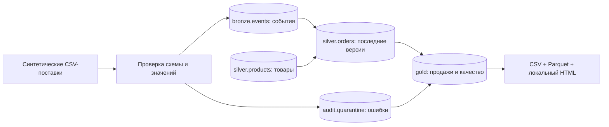

# Конвейер продаж — учебный проект дата-инженера

Junior Retail Pipeline — небольшой проект для портфолио: две синтетические CSV-поставки
превращаются в локальное аналитическое хранилище, проверенные SQL-витрины,
выгрузки Parquet и отчёт на русском языке.

[Краткая инструкция](docs/README-RU.md) · [Архитектура](docs/ARCHITECTURE.md) ·
[Схема данных](docs/DATA-CONTRACT.md) · [Подробный конспект](NOTES.md) ·
[Разбор для собеседования](docs/INTERVIEW.md)

## Что показывает проект

- Загрузка только нового содержимого: переименованная копия файла не загружается повторно.
- Удаление дублей и версии заказов: позднее старое событие не отменяет новое обновление.
- Карантин ошибочных строк, проверка неизменности событий и откат конфликтующего пакета.
- Оконные функции SQL, объединение таблиц, группировки и сверка выручки.
- Слои DuckDB, выгрузки CSV/Parquet и самостоятельный HTML-отчёт.
- Воспроизводимые демоданные, автоматические тесты и подготовленные проверки для Linux и Windows.



## Быстрый запуск

Нужен Python 3.11 или 3.12. Сервер базы, ключи API и облачный аккаунт не требуются.
В каталоге проекта создайте окружение:

```sh
python -m venv .venv
```

Linux/macOS: `source .venv/bin/activate`.
Windows PowerShell: `.venv\Scripts\Activate.ps1`.
Если активация в PowerShell запрещена, используйте `.venv\Scripts\python.exe`
вместо `python` в следующих командах.

```sh
python -m pip install --only-binary=:all: -r requirements.txt
python -m retail_pipeline demo
python -m retail_pipeline run
```

Откройте `workspace/output/report.html` в браузере. Отчёту не нужен сервер.
Демо создаёт 10 000 заказов, 1 000 обновлений, 100 дублей и 6 ошибочных строк.
После обработки в базе будет **11 000 уникальных событий, 10 000 актуальных заказов,
9 000 оплаченных заказов и 6 строк в карантине**. Валюта — USD, суммы хранятся в центах.

## Проверка

```sh
python -m retail_pipeline run
python -m unittest discover -s tests -v
python scripts/check_public.py
```

Повторный запуск сообщает: загружено файлов — 0, пропущено загруженных ранее файлов — 2,
добавлено событий — 0. Итоговые суммы и таблицы продаж сохраняются;
в журнал запуска добавляется ещё одна запись. Тесты проверяют обновления, повторы,
конфликты, откат пакета, ошибки строк и восстановление выгрузки после сбоя.

Чтобы посмотреть поставки по отдельности, создайте демо в другой папке.
Сначала перенесите в рабочую папку только `001-initial.csv` и запустите обработку.
Затем добавьте `002-updates.csv` и повторите запуск: изменятся 1 000 существующих заказов.

Команды и ошибки по умолчанию выводятся по-русски. Для автоматизации есть JSON
с неизменными техническими ключами:

```sh
python -m retail_pipeline run --json
```

## Как посмотреть таблицы

```python
import duckdb

with duckdb.connect("workspace/warehouse.duckdb", read_only=True) as db:
    print(db.sql("SELECT * FROM gold.product_sales ORDER BY revenue_cents DESC").fetchall())
    print(db.sql("SELECT * FROM gold.quality_summary ORDER BY reason").fetchall())
```

Определения SQL находятся в `retail_pipeline/sql/`. В заказе одна товарная позиция.
Последнее состояние определяется наибольшей версией. Возврат пересчитывает продажи
за исходную дату заказа. Для бухгалтерского учёта нужна другая модель.

## Свои локальные данные

```sh
python -m retail_pipeline run --input workspace/my-input --database workspace/my-warehouse.duckdb --output workspace/my-output
```

CSV должен соответствовать [схеме](docs/DATA-CONTRACT.md). Конфликт идентификатора
события или версии заказа отменяет весь новый пакет. Остальные ошибочные строки
попадают в карантин с кодом причины, без копирования исходного содержимого.

Ограничения: до 100 CSV-файлов, до 32 МиБ на файл и до 250 000 новых строк за запуск.
Пакет читается в память, небольшие витрины пересчитываются целиком.
Проект рассчитан на обучение и небольшие локальные наборы данных.

## Публикация и приватность

Генератор использует константы и начальное значение случайных чисел; личные файлы
и профиль пользователя не читает. Папки `workspace/` и `artifacts/` исключены из Git.
В релиз входят только файлы из `PUBLIC_FILES.txt`. Проверка публикации сканирует
их содержимое на контакты и типичные секреты. Адреса авторства Git проверяются
отдельно: для адресов вне домена no-reply выводится примечание без самого адреса.
Для будущих изменений всё равно нужен просмотр содержимого.

Не добавляйте настоящие входные данные, базы, отчёты, пароли и персональные сведения.
В приложении нет телеметрии, сетевого клиента и адреса поддержки.
Установка зависимостей и GitHub Actions используют сеть.
Подробнее: [приватность](docs/PRIVACY.md), [технологии](TECHNOLOGIES.md),
[результаты проверок](VALIDATION.md).

## Возможное развитие

Несколько товарных позиций в заказе, обновление отдельных разделов витрин,
планировщик, миграции схемы, модели dbt и источник PostgreSQL.
Каждую возможность стоит добавлять под конкретную задачу.

Версия 0.1.0. [Лицензия MIT на русском](LICENSE-RU.md); оригинальный текст — в LICENSE.
